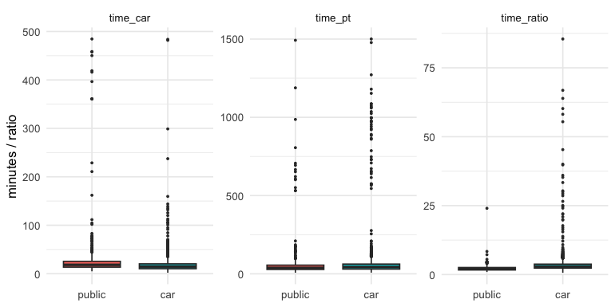
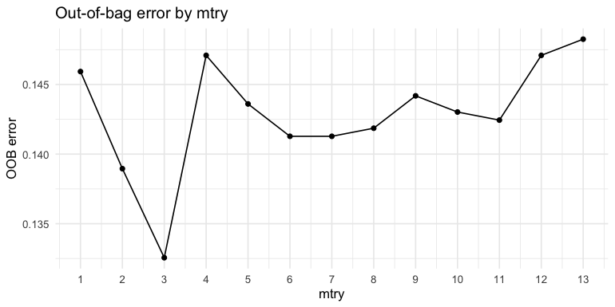
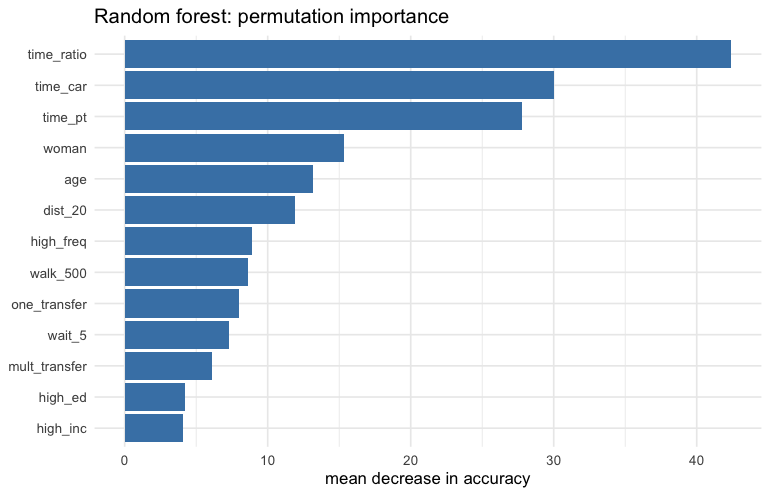
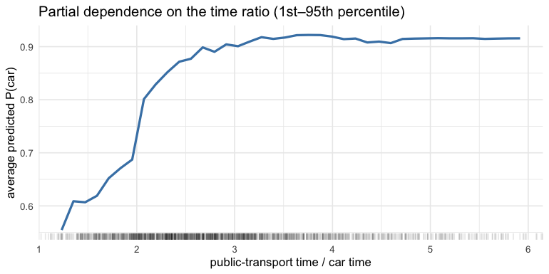
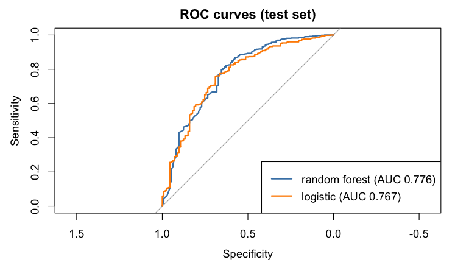

Car or public transport? Random forest vs logistic regression for
commuter mode choice
================

- [1. Data](#1-data)
- [2. Train/test split and
  evaluation](#2-traintest-split-and-evaluation)
- [3. Random forest](#3-random-forest)
- [4. Logistic regression benchmark](#4-logistic-regression-benchmark)
- [5. Comparison on the test set](#5-comparison-on-the-test-set)
- [Conclusions](#conclusions)

**Question:** what makes commuters outside Sweden’s metropolitan regions
choose the car over public transport? How well can that choice be
predicted?

**Data:** 2,475 commuters. Each record has: - the chosen mode (car or
public transport); - door-to-door travel times by public transport and
by car, and their ratio; - trip and public-transport service
characteristics (all dummies): - one or multiple transfers; - a walk of
**more than** 500 m to the nearest stop; - a transfer wait of more than
5 minutes; - high frequency (more than 8 departures per hour); - a trip
distance over 20 km; - demographics: age, gender, high income, high
education.

**Approach:** - A random forest with `mtry` tuned on the out-of-bag
error. - Compared with a logistic regression, the classic
discrete-choice benchmark. - Evaluated with metrics that account for the
class imbalance: most commuters drive.

``` r
library(tidyverse)
library(randomForest)
library(pROC)
library(broom)
library(knitr)
```

## 1. Data

``` r
load("data/TransportModeSweden.RData")   # data frame `data`
transport <- data |>
  mutate(across(c(time_pt, time_car, time_ratio), ~ as.numeric(gsub(",", ".", .x))),  # decimal commas
         mode = factor(mode, levels = c(0, 1), labels = c("public", "car")))
cat("missing values per column:\n"); print(colSums(is.na(transport))[colSums(is.na(transport)) > 0])
```

    ## missing values per column:

    ## walk_500 
    ##       17

``` r
transport <- transport[complete.cases(transport), ]
cat(nrow(transport), "complete cases\n")
```

    ## 2458 complete cases

``` r
round(prop.table(table(transport$mode)), 3)
```

    ## 
    ## public    car 
    ##  0.148  0.852

The data is imbalanced: about 4 in 5 commuters drive. A model that
always predicts “car” is already about 80% accurate, so accuracy alone
says little. Balanced accuracy (the mean of the two class-wise hit
rates) and AUC are reported alongside it.

``` r
transport |> select(mode, time_pt, time_car, time_ratio) |> pivot_longer(-mode) |>
  ggplot(aes(mode, value, fill = mode)) + geom_boxplot(show.legend = FALSE, outlier.size = 0.5) +
  facet_wrap(~ name, scales = "free_y") + theme_minimal() + labs(x = NULL, y = "minutes / ratio")
```



## 2. Train/test split and evaluation

``` r
set.seed(123)
idx <- sample(nrow(transport), floor(0.7 * nrow(transport)))
train <- transport[idx, ]; test <- transport[-idx, ]

evaluate <- function(prob_car, truth, threshold = 0.5) {
  pred <- factor(ifelse(prob_car >= threshold, "car", "public"), levels = c("public", "car"))
  sens_pt  <- mean(pred[truth == "public"] == "public")   # public-transport users found
  sens_car <- mean(pred[truth == "car"] == "car")
  c(accuracy = mean(pred == truth), `recall public` = sens_pt, `recall car` = sens_car,
    `balanced accuracy` = (sens_pt + sens_car) / 2, AUC = as.numeric(auc(truth, prob_car, quiet = TRUE)))
}
```

## 3. Random forest

A baseline forest uses 500 trees and the default `mtry` = ⌊√13⌋ = 3.
Tuning then compares the out-of-bag (OOB) error over every `mtry` from 1
to 13. OOB error is computed on the trees that did not see an
observation, so it serves as a built-in validation estimate without
touching the test set.

``` r
set.seed(123)
oob <- sapply(1:13, function(m) randomForest(mode ~ ., data = train, ntree = 500, mtry = m)$err.rate[500, "OOB"])
tibble(mtry = 1:13, `OOB error` = oob) |>
  ggplot(aes(mtry, `OOB error`)) + geom_line() + geom_point() + theme_minimal() +
  scale_x_continuous(breaks = 1:13) + labs(title = "Out-of-bag error by mtry")
```



``` r
best_mtry <- which.min(oob)
cat("best mtry:", best_mtry, "| OOB error:", round(min(oob), 4), "\n")
```

    ## best mtry: 3 | OOB error: 0.1326

``` r
set.seed(123)
rf <- randomForest(mode ~ ., data = train, ntree = 500, mtry = best_mtry, importance = TRUE)
rf
```

    ## 
    ## Call:
    ##  randomForest(formula = mode ~ ., data = train, ntree = 500, mtry = best_mtry,      importance = TRUE) 
    ##                Type of random forest: classification
    ##                      Number of trees: 500
    ## No. of variables tried at each split: 3
    ## 
    ##         OOB estimate of  error rate: 13.49%
    ## Confusion matrix:
    ##        public  car class.error
    ## public     58  193  0.76892430
    ## car        39 1430  0.02654867

``` r
prob_rf <- predict(rf, test, type = "prob")[, "car"]
table(predicted = predict(rf, test), actual = test$mode)
```

    ##          actual
    ## predicted public car
    ##    public     31  12
    ##    car        82 613

``` r
imp <- importance(rf, type = 1)   # mean decrease in accuracy (permutation importance)
tibble(variable = rownames(imp), importance = imp[, 1]) |>
  ggplot(aes(reorder(variable, importance), importance)) + geom_col(fill = "steelblue") + coord_flip() +
  theme_minimal() + labs(x = NULL, y = "mean decrease in accuracy", title = "Random forest: permutation importance")
```



**How does the travel-time ratio shift the choice?** A partial
dependence plot shows the model’s average predicted log-odds of choosing
the car as the ratio of public-transport to car travel time varies, with
every other variable kept at its observed values:

``` r
quantile(train$time_ratio, c(0.01, 0.25, 0.5, 0.75, 0.99))
```

    ##        1%       25%       50%       75%       99% 
    ##  1.232449  2.200159  2.797445  3.637519 21.789457

``` r
grid <- seq(quantile(train$time_ratio, 0.01), quantile(train$time_ratio, 0.95), length.out = 40)
pdp <- sapply(grid, function(g) mean(predict(rf, mutate(train, time_ratio = g), type = "prob")[, "car"]))
ggplot(tibble(ratio = grid, p = pdp), aes(ratio, p)) + geom_line(linewidth = 1, colour = "steelblue") +
  geom_rug(data = train, aes(x = time_ratio), inherit.aes = FALSE, alpha = 0.1) +
  coord_cartesian(xlim = range(grid)) + theme_minimal() +
  labs(x = "public-transport time / car time", y = "average predicted P(car)",
       title = "Partial dependence on the time ratio (1st–95th percentile)")
```



``` r
tibble(ratio = c(1.5, 2, 3, 5)) |>
  mutate(`P(car)` = sapply(ratio, function(g) mean(predict(rf, mutate(train, time_ratio = g), type = "prob")[, "car"]))) |>
  kable(digits = 3)
```

| ratio | P(car) |
|------:|-------:|
|   1.5 |  0.605 |
|   2.0 |  0.781 |
|   3.0 |  0.905 |
|   5.0 |  0.916 |

## 4. Logistic regression benchmark

Logistic regression is the standard model for binary mode choice. Its
coefficients are odds ratios that can be read directly. Unlike variable
importance, they also give the *direction* of each effect.

``` r
logit <- glm(mode ~ ., data = train, family = binomial)
tidy(logit, exponentiate = TRUE, conf.int = TRUE) |>
  mutate(across(where(is.numeric), ~ round(.x, 3))) |>
  rename(`odds ratio` = estimate) |> kable(caption = "Logistic regression: odds of choosing the car")
```

| term          | odds ratio | std.error | statistic | p.value | conf.low | conf.high |
|:--------------|-----------:|----------:|----------:|--------:|---------:|----------:|
| (Intercept)   |      0.622 |     0.428 |    -1.109 |   0.268 |    0.269 |     1.441 |
| time_pt       |      0.994 |     0.002 |    -3.089 |   0.002 |    0.991 |     0.998 |
| time_car      |      1.002 |     0.004 |     0.579 |   0.562 |    0.994 |     1.010 |
| time_ratio    |      2.505 |     0.116 |     7.915 |   0.000 |    2.010 |     3.167 |
| one_transfer  |      1.880 |     0.303 |     2.085 |   0.037 |    1.068 |     3.527 |
| mult_transfer |      2.953 |     0.502 |     2.159 |   0.031 |    1.138 |     8.185 |
| walk_500      |      1.382 |     0.162 |     1.993 |   0.046 |    1.008 |     1.907 |
| wait_5        |      1.042 |     0.333 |     0.123 |   0.902 |    0.528 |     1.962 |
| high_freq     |      0.524 |     0.172 |    -3.744 |   0.000 |    0.375 |     0.738 |
| dist_20       |      0.523 |     0.221 |    -2.930 |   0.003 |    0.340 |     0.810 |
| high_inc      |      1.249 |     0.159 |     1.399 |   0.162 |    0.913 |     1.706 |
| high_ed       |      0.994 |     0.165 |    -0.038 |   0.970 |    0.716 |     1.372 |
| woman         |      0.528 |     0.152 |    -4.212 |   0.000 |    0.392 |     0.710 |
| age           |      1.003 |     0.006 |     0.530 |   0.596 |    0.991 |     1.015 |

Logistic regression: odds of choosing the car

``` r
prob_logit <- predict(logit, test, type = "response")
```

**Reading the odds ratios** (holding the other variables fixed): -
**Travel-time ratio:** each one-unit increase in the ratio of
public-transport to car time multiplies the odds of driving by about
2.5. - **Transfers:** one transfer raises the odds of driving by about
1.9×, multiple transfers by about 3×. - **Walk to the stop:** a walk of
more than 500 m raises them by about 1.4×. - **Service frequency:** more
than 8 departures per hour roughly *halves* the odds of driving (OR ≈
0.52). - **Trip length:** trips over 20 km also halve the odds (OR ≈
0.52). These are presumably commuter-rail corridors. - **Gender:** women
have about half the odds of driving that men have (OR ≈ 0.53). - **Other
variables:** income, education, age and the transfer wait are not
significant.

## 5. Comparison on the test set

``` r
base_rate <- mean(train$mode == "car")
results <- rbind(
  `Always "car"`                     = evaluate(rep(base_rate, nrow(test)), test$mode, threshold = 0),
  `Logistic regression (0.5)`        = evaluate(prob_logit, test$mode),
  `Random forest (0.5)`              = evaluate(prob_rf, test$mode),
  `Random forest (threshold = share of car users)` = evaluate(prob_rf, test$mode, threshold = base_rate)
)
kable(results, digits = 3)
```

|  | accuracy | recall public | recall car | balanced accuracy | AUC |
|:---|---:|---:|---:|---:|---:|
| Always “car” | 0.847 | 0.000 | 1.000 | 0.500 | 0.500 |
| Logistic regression (0.5) | 0.850 | 0.071 | 0.990 | 0.531 | 0.767 |
| Random forest (0.5) | 0.871 | 0.265 | 0.981 | 0.623 | 0.776 |
| Random forest (threshold = share of car users) | 0.722 | 0.673 | 0.731 | 0.702 | 0.776 |

``` r
roc_rf <- roc(test$mode, prob_rf, quiet = TRUE); roc_lg <- roc(test$mode, prob_logit, quiet = TRUE)
plot(roc_rf, col = "steelblue", main = "ROC curves (test set)"); plot(roc_lg, col = "darkorange", add = TRUE)
legend("bottomright", c(sprintf("random forest (AUC %.3f)", auc(roc_rf)), sprintf("logistic (AUC %.3f)", auc(roc_lg))),
       col = c("steelblue", "darkorange"), lwd = 2)
```



``` r
roc.test(roc_rf, roc_lg)   # DeLong test for the AUC difference
```

    ## 
    ##  DeLong's test for two correlated ROC curves
    ## 
    ## data:  roc_rf and roc_lg
    ## Z = 0.43457, p-value = 0.6639
    ## alternative hypothesis: true difference in AUC is not equal to 0
    ## 95 percent confidence interval:
    ##  -0.02860262  0.04489997
    ## sample estimates:
    ## AUC of roc1 AUC of roc2 
    ##   0.7756106   0.7674619

## Conclusions

- **Travel-time competitiveness drives the choice.** The ratio of
  public-transport to car travel time is the most important predictor in
  the forest and the strongest effect in the logit (OR ≈ 2.5 per unit).
  Public transport is slower than the car for every commuter in the data
  (the lowest ratios are about 1.2). The partial dependence plot shows
  the probability of driving rising as that gap widens:
- 0.61 when public transport takes 1.5× as long as the car;
- 0.78 at 2×;
- 0.91 at 3×;
- almost no further change beyond that.

The competitive window is narrow. Public transport wins riders only when
it is within about twice the car’s travel time. - **Service design
matters too, in the expected direction.** Transfers and long walks to
the stop push commuters into the car. High-frequency service pulls them
out. - **Prediction.** - Both models beat the always-“car” baseline on
AUC: 0.78 for the forest and 0.77 for the logit, against 0.50. - At the
default 0.5 threshold, though, the forest finds only 27% of
public-transport users and the logit only 7%. High accuracy here mostly
reflects the 85% car share. - Setting the threshold to the share of car
users lifts recall of public-transport users to 67% and balanced
accuracy from 0.62 to 0.70, at the cost of more misclassified drivers. -
**Random forest vs logit.** The forest’s AUC advantage is small and not
significant (DeLong p ≈ 0.66). For this problem the interpretable logit
predicts about as well, and it also explains each effect. - **Policy
reading.** The largest lever is making public transport time-competitive
with the car through faster, more direct and more frequent connections,
with fewer transfers.
